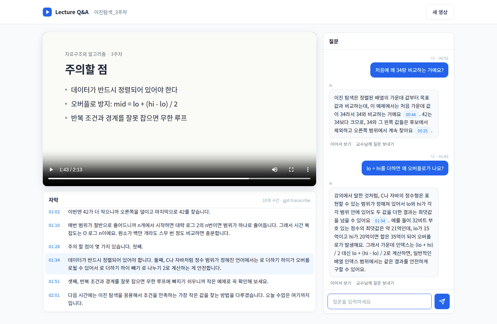

# Lecture Q&A

Pause a lecture video, ask a question, and get an answer drawn from the
lecture's transcript, with links back to the moments it used.



When you watch a recorded lecture, the question is usually about the last
few minutes, not about the topic in general. Lecture Q&A transcribes the
video first. When you pause and ask, the model gets the timestamped
transcript (only a window around that spot if the lecture is very long) and
where you stopped, answers from that, and cites moments like `[01:34]`,
which turn into buttons that seek the video. If the answer still doesn't
help, the question can be forwarded to the professor by email.

The interface is in Korean; questions and answers work in any language the
models handle.

Side project, not deployed anywhere at the moment. The screenshot shows a
short demo lecture made for testing.

## How it works

1. **Video in.** Either an uploaded MP4/WebM file, checked with `ffprobe`
   restricted to the MP4 and Matroska demuxers, or a YouTube link. For
   YouTube only the video id is kept; the server builds the URL itself,
   downloads just the audio track with yt-dlp, and the page plays the video
   through YouTube's embedded player.
2. **Transcript.** ffmpeg decodes the audio to 16 kHz mono. OpenAI's
   `gpt-transcribe` returns text without timestamps, so the audio is cut at
   the quietest point every 5 to 20 seconds, the chunks are transcribed in
   parallel, and each chunk becomes one timestamped line. In my tests a
   7.7 minute lecture took about 8 seconds.
3. **Questions.** The question, the transcript with a marker at the pause
   position, and the last three exchanges go to `gpt-6.1-sol` through the
   Responses API, and the answer streams back over server-sent events.
4. **Ask the professor (optional).** Sends the question, the stored answer,
   the student's comment and a short transcript excerpt from before the
   question through Resend, with an optional reply-to address.

## Running it locally

You need Python 3.12+, ffmpeg and an OpenAI API key. For YouTube links,
install [Deno](https://deno.com/) as well; yt-dlp uses it to read YouTube's
player code.

```bash
python3 -m venv .venv && source .venv/bin/activate
pip install -r requirements.txt
cp .env.example .env        # set OPENAI_API_KEY
python -m backend.app       # http://127.0.0.1:5000
```

Tests run offline (the OpenAI and Resend calls are faked):

```bash
pip install -r requirements-dev.txt
pytest
```

## Deploying with Docker

```bash
cp .env.example .env        # OPENAI_API_KEY, and DOMAIN for HTTPS
docker compose up -d --build
```

Caddy terminates TLS for `DOMAIN` and forwards to gunicorn. Keep gunicorn at
one worker: job progress lives in that process's memory. Videos and
transcripts go to the `app-data` volume and are deleted once they are older
than `RETENTION_HOURS` (checked every 10 minutes).

If YouTube starts blocking the server, export cookies from a browser and
mount them with a `docker-compose.override.yml`:

```yaml
services:
  app:
    volumes:
      - ./cookies.txt:/app/cookies.txt:ro
    environment:
      YTDLP_COOKIES: /app/cookies.txt
```

## Configuration

Everything is read from environment variables (or `.env`):

| Variable | Default | |
|---|---|---|
| `OPENAI_API_KEY` | | required |
| `TRANSCRIBE_MODEL` | `gpt-transcribe` | `whisper-1` and `gpt-4o-transcribe-diarize` return their own timestamps, but are [shut down on 2027-02-26](https://developers.openai.com/api/docs/deprecations) |
| `TRANSCRIBE_LANGUAGE` | auto | e.g. `ko` |
| `CHAT_MODEL` / `CHAT_REASONING_EFFORT` | `gpt-6.1-sol` / `low` | `gpt-6-luna` with `none` is faster and cheaper |
| `CHAT_MAX_OUTPUT_TOKENS` | `1000` | |
| `USE_LOCAL_WHISPER` / `WHISPER_MODEL` | `false` / `small` | transcribe on the machine; needs `requirements-local-whisper.txt` |
| `MAX_VIDEO_MINUTES` / `MAX_UPLOAD_MB` | `20` / `300` | |
| `JOB_WORKERS` / `MAX_PENDING_JOBS` | `2` / `8` | transcription jobs running / running plus queued |
| `MAX_CONCURRENT_ANSWERS` | `4` | answers streaming at the same time |
| `RATE_LIMIT_VIDEOS_PER_HOUR` / `RATE_LIMIT_QUESTIONS_PER_HOUR` | `10` / `60` | per IP, `0` turns a limit off |
| `RATE_LIMIT_FEEDBACK_PER_DAY` | `10` | professor mails per IP |
| `RETENTION_HOURS` | `48` | `0` keeps everything |
| `PROFESSOR_EMAIL`, `RESEND_API_KEY`, `FEEDBACK_FROM` | | all three enable the professor mail |
| `YTDLP_COOKIES` | | cookies file for when YouTube blocks the server |

## Limitations

- The model only hears the lecture. Slides, code on screen and the
  whiteboard are invisible to it.
- Transcripts are machine-made and can mishear terms. With
  `gpt-transcribe`, timestamps are per chunk (5 to 20 seconds), not per word.
- YouTube sometimes refuses downloads from server IPs ("sign in to confirm
  you're not a bot"). Cookies sometimes help; otherwise upload the video
  file instead. Videos whose owner disabled embedding can't be played here.
- No accounts. Uploaded videos are served from random, unlisted URLs, so
  don't put anything private on a public instance.
- Job state is in memory. A restart loses running jobs; finished
  transcripts stay on disk.

## Stack

Flask and gunicorn, the OpenAI API (`gpt-transcribe`, Responses API),
yt-dlp, ffmpeg, plain JavaScript and CSS, Caddy and Docker Compose.

## 한국어 소개

강의 영상을 올리거나 YouTube 주소를 넣으면 음성을 자막으로 만들고, 영상을
보다가 멈춘 지점에서 질문하면 그 부분의 강의 내용을 근거로 답합니다. 답에
나온 `[01:34]` 같은 시간은 누르면 해당 장면으로 이동하고, 자막 줄을 눌러도
그 위치로 갑니다. AI 답변이 부족하면 질문과 답변을 교수님께 메일로 보낼 수
있습니다 (Resend 설정 시).

실행: `.env.example`을 `.env`로 복사해 `OPENAI_API_KEY`를 넣고
`python -m backend.app` 또는 `docker compose up -d --build`.

## License

MIT
